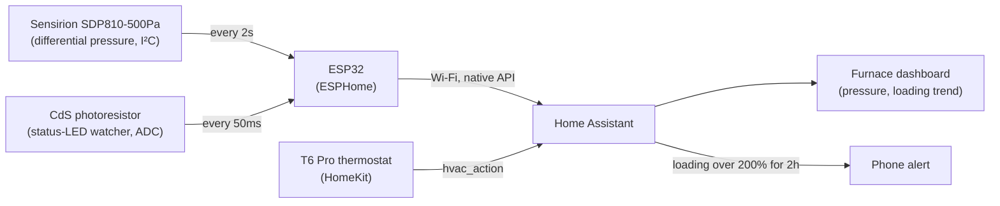

## The problem

Furnace filters get replaced on a calendar, or whenever someone remembers.
Neither has much to do with how dirty the filter actually is. The furnace's
own diagnostics aren't much better: a Carrier control board blinks an LED to
report fault codes, but that's only useful if someone is standing in the
basement watching it at the moment it blinks.

## The solution

One ESP32 in the furnace room reads **differential pressure across the
filter** and watches the control board's **status LED**. Home Assistant turns
the pressure reading into blower speed, a per-speed filter-loading
percentage, and a phone alert, calibrated against a real baseline instead of
a generic "replace every 90 days" rule. The LED watcher is built and
reporting, but decoding its blink pattern into an actual fault code isn't
done yet (see [Not done yet](#not-done-yet)).

## Architecture



The ESP32 only ever reports two raw numbers: differential pressure and a
light-sensor voltage. Every derived value (blower speed, filter loading, the
blink-detection binary sensor) is computed in Home Assistant as UI-created
template helpers, not in the firmware. That keeps the firmware simple and
makes the logic easy to retune without reflashing.

## Hardware

| Component | Part | Notes |
|---|---|---|
| MCU | ESP32 (`esp32dev`, WROOM-32) | Arduino framework, 160 MHz |
| Pressure sensor | Sensirion **SDP810-500Pa** | I²C, address `0x25`, SDA GPIO16 / SCL GPIO17. Differential-pressure mode, read every 2 s. Factory-calibrated and temperature-compensated. |
| Status-LED sensor | CdS photoresistor | Voltage divider: 3V3 → CdS → GPIO34, 10 kΩ to GND. Sampled every 50 ms. |
| Furnace control board | Carrier CEPL131102 | Two status LEDs (LED1, LED2) sit close enough together that the CdS cell can't optically separate them, so it watches both as one combined signal. |
| Thermostat | Honeywell/Resideo **T6 Pro** | HomeKit-connected. Reports only `heating` / `cooling` / `idle` via `hvac_action`, with no fan speed or fan mode. |

Protoboard build, no schematic or PCB.

An earlier revision of the config ran I²C on GPIO21/22. Those pins were later
retired as electrically damaged, which is why the sensor now sits on
GPIO16/17.


ESPHome's built-in web server shows the live readings. IP and MAC address are
cropped out below, same privacy treatment as the rest of the site:


### Why the pressure sensor changed: MPX10DP → SDP810

The first version of this monitor used an **MPX10DP** analog differential
bridge sensor, read through an **HX711** 24-bit ADC. That combination needed
a stored zero offset, an SHT40 to measure the sensor's own body temperature,
and a temperature-coefficient correction to keep the zero point from
drifting with ambient temperature. That's a lot of plumbing just to get a
trustworthy number. The **SDP810** replaced all of it: it's a digital,
factory-calibrated, temperature-compensated sensor that reports differential
pressure directly over I²C. The zero-offset storage, the body-temperature
sensor, and the drift correction all went away at once. The MPX10DP version
is kept archived rather than deleted, in case the SDP810 ever needs comparing
against it.

On the firmware side, the SDP810's native hPa reading comes out of the
sensor with the sign flipped (see [Subtle features](#subtle-features)), then
runs through a 5-sample median filter followed by an EMA (α = 0.2) before
being exposed in Pa (×100 from hPa), alongside a diagnostic raw-hPa value for
troubleshooting.

## Reading the blower from the pressure

With a clean filter installed, the differential pressure settles into three
distinct, repeatable levels:

| Blower state | Clean-filter pressure | Notes |
|---|---|---|
| Off | ~0 Pa | |
| Low (continuous circulate) | **35.1 Pa** (0.14 in. w.c.) | The thermostat's fan is set to "On", so this is the idle norm, not an edge case |
| High (heating) | **87.4 Pa** (0.35 in. w.c.) | Matches every thermostat heat call exactly; a brief dip to ~1 Pa at the start of each call is the furnace pausing the blower while the burner lights |

Pressure alone can't say *which* speed the blower is running at. A clogged
filter raises the pressure at every speed, so a fixed Pa cutoff misclassifies
speed as the filter loads (see
[the bug below](#the-bug-the-experiment-caught)). Blower speed instead comes
from the **thermostat**: `heating` or `cooling` in `hvac_action` means high
speed, anything else means low. Pressure is only used to detect "blower off"
(below 5 Pa). To avoid catching the furnace's pause-at-ignition dip and the
blower's run-on after a heat call ends, a reading is only trusted once the
inferred speed has held steady for 180 s (low) or 120 s (high).

## Filter loading and the alert

Each speed gets its own 24-hour rolling mean, and loading is computed as a
ratio against a clean-filter **baseline** for that same speed, taken as a
percentage. The higher of the two speeds' ratios is used as the overall
loading figure, since a clogged filter typically shows up more clearly at
high flow.

The whole thing is built from Home Assistant UI helpers; there's no YAML
repo for this layer:

| Entity | Type | Logic |
|---|---|---|
| Furnace Fan Speed | template sensor | `off` if pressure < 5 Pa, else `high` if thermostat is heating/cooling, else `low` |
| Filter DP Low Fan / High Fan | template sensors | Hold the last pressure reading once speed has been steady (180 s / 120 s) |
| …24h Mean (×2) | statistics helpers | 24-hour mean of each speed's held reading |
| Furnace Filter Loading | template sensor | 24h mean ÷ clean baseline, as a %, higher of the two speeds |
| Blower Off During Heat Call | template binary sensor | Heat call active for more than 5 min with pressure below 5 Pa. A real safety fault: no airflow across the heat exchanger |
| Baseline Low / High, Replace Threshold | input_number | Clean-filter reference values, plus the 200% alert threshold |
| Filter Replaced | input_button + input_datetime | Pressed after a filter change; timestamps the swap |

Automations:

- **Record Replacement** stores the replacement date when the button is pressed.
- **Capture Baseline** runs at 3 AM, 24–48 h after a replacement, and copies the current 24h means into the clean baselines.
- **Replace Alert** sends a phone notification when loading stays above threshold for 2 h, plus a daily 6 PM reminder. It's suppressed for 24 h after a replacement so the old filter's data still sitting in the 24h buffer can't trigger a false alert.

A dedicated **Furnace dashboard** shows a log-scale 24-hour pressure graph
(off/low/high plotted together), per-speed hourly graphs that auto-scale so
small drifts are visible, and a daily loading trend.


Core logic, generalized to readable entity names:

```jinja
{# Furnace Fan Speed #}


{{ 'off' if p < 5 else ('high' if a in ['heating', 'cooling'] else 'low') }}

{# Filter DP Low Fan: hold the last steady reading #}


{{ p | round(1) }}
{{ this.state if this.state | is_number else none }}
```

## Testing and validation

### The old-filter experiment

The goal was to calibrate a "replace now" threshold from measured data
instead of a guessed limit:

1. A clean filter goes in **Oct 3–5**, with a baseline captured automatically 24 h after install.
2. An old, used filter is swapped in from **Oct 5–10**.
3. The good filter goes back in on **Oct 10**, and the fan-speed logic switches
   to reading the thermostat (see [the bug below](#the-bug-the-experiment-caught)).
4. An automatic baseline recapture runs **Oct 12 at 3 AM**, locking in the corrected
   numbers on the fixed logic.

| Blower | Clean | Old filter | Ratio |
|---|---|---|---|
| Low (circulate) | 35.1 Pa | ~104 Pa | ~3× |
| High (heating) | 87.4 Pa (mean) | ~244 Pa (peak) | ~2.5–2.8× |

Comparing like-for-like (clean high-speed *peaks* of ~95–99 Pa against the
old filter's high-speed *peak* of 244 Pa) lands at about 2.5×. The high/low
pressure ratio stays roughly 2.4–2.5× with either filter installed, which
means the blower's speed ratio is a stable property independent of filter
condition. That stability is why speed detection relies on the thermostat
instead of pressure. The swap back to the clean filter shows up as a step
from 106 Pa to 36 Pa within a single 5-minute window.

**Replacement threshold: 200% of clean.** That's twice the clean-filter
pressure (about 70 Pa at low speed, 175 Pa at high), the common "replace at
2× clean ΔP" rule. The old filter, at roughly 3×, was well past due.

The dashboard's own pressure and loading history show the whole cycle: the
climb when the old filter went in, the plateau while it stayed in, and the
fan-speed color bar across the log-scale pressure graph that makes the
ignition-pause dips and the low/high split easy to read at a glance.


The cycle is tracked live in a Home Assistant helper rather than just in
memory, which helps for a multi-day test with automated steps in the middle.
As of this writing it's on the last step, waiting on the Oct 12 baseline
recapture to close it out:


### The bug the experiment caught

An earlier version of the Home Assistant logic classified blower speed by
fixed pressure cutoffs: below 10 Pa off, 10–60 Pa low, above 60 Pa high. With
the old filter installed, *low* speed ran at 104 Pa, above the "high"
cutoff, so it was misclassified as high speed. The consequences:

- The low-speed reading froze in place.
- The high-speed average mixed circulate and heat-call readings together.
- Filter loading read about **128%** instead of the real **~300%**.
- The alert would never have fired.

The flaw is basic: a clogged filter raises pressure at *every* speed, so
pressure can't be the signal that tells you which speed you're at. The fix
was switching speed detection to the thermostat's `hvac_action`, with
pressure used only to detect "off" (described above). The raw pressure
readings stayed intact in the history the whole time, which is how the real
3× figure was recovered after the derived sensors had already shown the
wrong value.

## Subtle features

A few details that don't fall out of the config at a glance:

- **Sign flip.** The pressure hoses landed on the sensor's ports such that a
  loading filter read *negative*. `multiply: -1` in firmware corrects it
  going forward; the already-recorded history was corrected in the database.
- **Baseline-deviation detection, not a fixed threshold.** LED1 on the
  control board is steady-on during normal operation, so a fixed brightness
  cutoff can't tell "normal" from "blinking." Instead the firmware tracks a
  slow EMA baseline (α = 0.01, ~5 s time constant) and fires a binary sensor
  when the raw reading deviates more than 0.15 V from it.
- **Log-scale graphing.** On a linear axis, the low-speed plateau and its
  drift get squashed against the high-speed peaks. A log-scale axis spaces
  off/low/high evenly so drift at any speed is visible.
- **Per-speed normalization.** Loading is a ratio to each speed's own clean
  baseline. That's what makes it possible to compare low-speed and
  high-speed loading on a single percentage scale.
- **The psi gotcha.** HA's `pressure` device class on a US-units install
  silently displays in psi. 35 Pa shows as 0.005 psi and rounds to 0 on most
  dashboards, so a unit override to Pa was required to make any of this
  readable.

## Not done yet

- **Blink-code decoding.** The CdS baseline-deviation detector reports *that*
  the LED is blinking, but not the actual Carrier fault code. That decoding
  isn't implemented, and the 0.15 V deviation threshold hasn't been tuned or
  validated against a known blink code yet.
- **A cooling-season data set.** All the pressure figures above are from
  heating calls; cooling-call behavior hasn't been characterized.
- **A second filter-life cycle**, to confirm the 200% threshold holds up over
  more than one replacement interval.

## Getting it

This project's ESPHome config isn't published yet. It currently lives
alongside other devices' network and secrets configuration in a private
repo. A cleaned, public-safe copy is planned, and this page will link to it
once that's ready. In the meantime, the hardware table, sensor facts, and
Jinja templates above are enough to reproduce the design.
